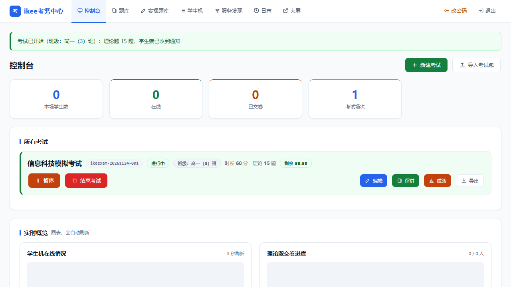
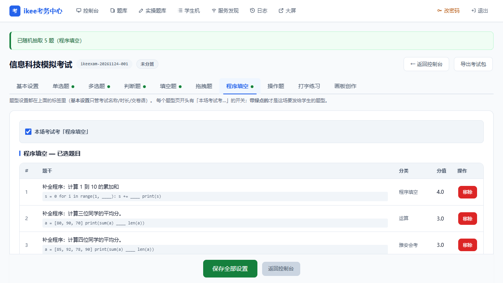
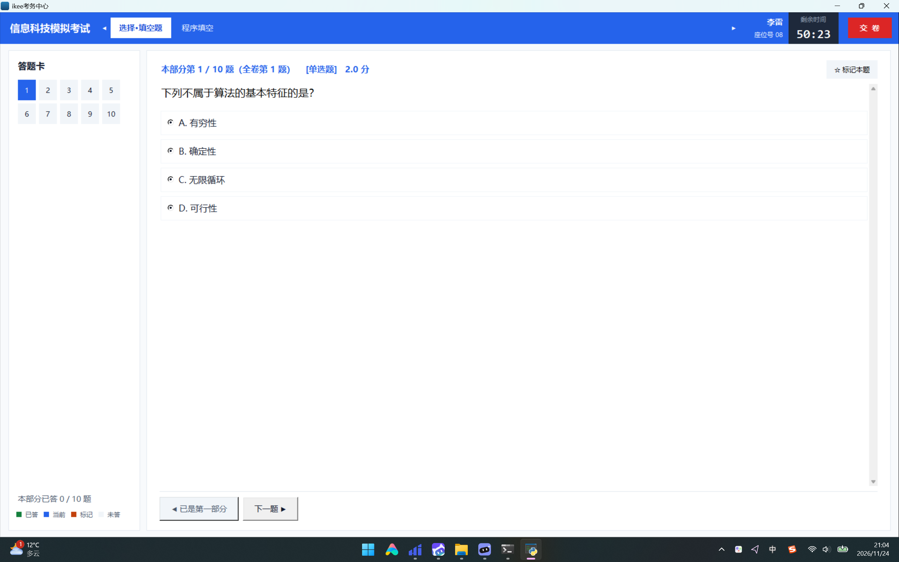
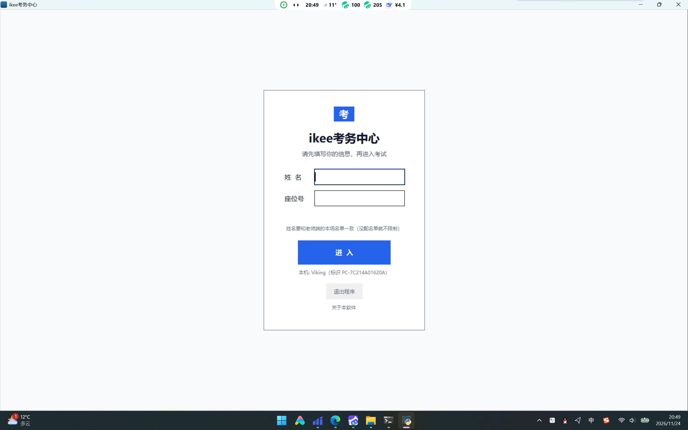
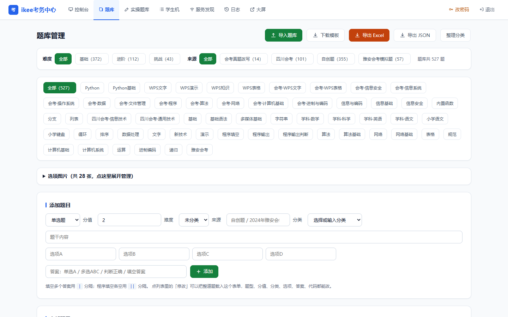
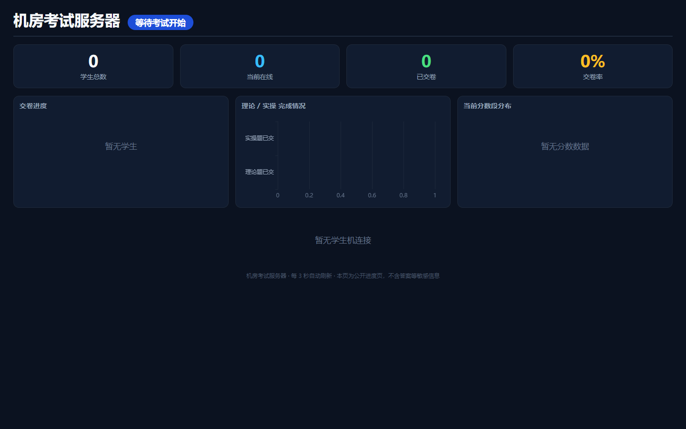
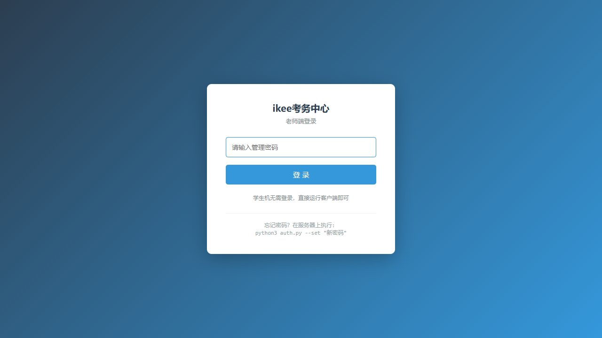

# ikee考务中心（ikeexam）

一个给机房用的完整考试系统：**先在线答理论题，再自动拉起 WPS 做实操题，交卷后自动评分出成绩。**

- 作者：**小可**
- 网站：https://www.ikee002.top/
- 仓库：https://github.com/zk26/ikeexam
- License：[MIT](./LICENSE)

## 功能特性

- **理论题**：单选 / 多选 / 判断 / 填空 / 程序填空（真跑代码判题）/ 拖拽题 / 打字题 / 画图题（小学模块）
- **实操题**：Word / Excel / PPT 三件套，自动下发素材、自动拉起 WPS、一键回收答卷
- **自动评分**：理论题即时判分；实操题按评分规则解析 docx/xlsx/pptx 自动打分
- **考试控制**：开始 / 暂停 / 切换阶段 / 结束，学生端心跳同步、断线自动重连
- **防作弊**：定时查杀违禁进程、锁屏加固（可选严格模式）
- **成绩导出**：CSV / Excel 明细、按班级打包答卷、抄袭检测
- **自动发现**：学生端 UDP 广播自动找到服务器，无需写死 IP

## 运行截图

| 老师端控制台（考试进行中） | 考试配置 · 从题库组卷 |
|:---:|:---:|
|  |  |

| 学生端答题界面（计算机二级风格） | 学生端登录（姓名 + 座位号） |
|:---:|:---:|
|  |  |

| 题库管理（527 题内置） | 实操题库（WPS 三件套） |
|:---:|:---:|
|  |  |

| 老师端登录 | 考试大屏（投屏用） |
|:---:|:---:|
|  |  |

## 架构

```
                    Linux/Windows 服务器（:9000）
                    ┌──────────────────────────────┐
                    │  Flask 后台 + SQLite          │
                    │  · 题库管理 / 组卷            │
                    │  · 考试控制（阶段切换）       │
                    │  · 素材下发 / 答卷回收        │
                    │  · 自动评分 + 成绩导出        │
                    │  · UDP 39100 广播（被发现）   │
                    └───────────┬──────────────────┘
                                │ HTTP + UDP 广播
        ┌───────────────────────┼───────────────────────┐
        │                       │                       │
   老师端（二选一）           学生机 ×N              学生机 ×N
   · Linux：浏览器网页        考试客户端              （同一程序）
   · Windows：桌面软件 exe
```

## 快速开始

```bash
# 1. 安装依赖
pip install flask openpyxl python-docx python-pptx pyyaml psutil

# 2. 启动服务端（Linux 部署；老师用浏览器访问网页后台）
cd server
python app.py
# 打开 http://127.0.0.1:9000 进入后台（首次运行会提示设置初始密码）

# 3. 学生端
cd client
python exam_client.py

# 4. 老师端桌面软件（Windows，可选：不装就继续用网页后台）
cd teacher
python teacher_app.py
```

> 三个角色都有现成的安装程序（学生端 exe、老师端桌面 exe），见 [`installer/README.md`](./installer/README.md)。
> 详细部署与使用见 [`使用说明.md`](./使用说明.md)。

## 目录结构

```
ikeexam/
├── server/           # 服务端（Flask 后台 + 判题沙箱）
│   ├── app.py        # 主程序（路由 / 考试控制 / 成绩）
│   ├── db.py         # SQLite 数据层
│   ├── coderun.py    # 程序填空判题
│   ├── sandbox.py    # 判题沙箱（资源限制）
│   └── templates/    # 老师端页面
├── client/           # 学生端（tkinter）
│   ├── exam_client.py
│   ├── gui.py
│   └── ...           # 各题型 UI / 运行器 / 守卫
├── teacher/          # 老师端桌面软件（Windows，原生 tkinter）
│   ├── teacher_app.py
│   └── api.py        # 管理员 HTTP 客户端
├── installer/        # Inno Setup 安装程序（学生端 + 老师端）
├── graders/          # 实操题评分器（word/excel/ppt）
├── 题库/             # 内置题库（含四川会考模拟题）
├── auto_rule.py      # 标准答案 → 评分规则
├── plagiarism.py     # 抄袭检测
└── grade.py          # 命令行评分工具
```

---

## OJ 判题模块（代码题 / 程序填空）

程序填空（`qtype="code"`）判题分两级（`server/db.py` 的 `judge()` + `server/coderun.py` + `server/sandbox.py`）：

1. **优先「真跑一遍比对输出」**：老师给题目配了 `expected_output` 后，把学生填好的代码真的执行一遍，输出归一化后与期望输出一致即满分。因为正确写法穷举不完（`range(1,11)` vs `range(1, 11)`、`for` vs `while`），不匹配参考答案。
2. **回退「按空给分」**：没配期望输出 / 空没填完 / 环境缺失时，退化为「对几个空得几分」的参考答案匹配。

`judge_code()` 的返回值契约：

| 返回值 | 含义 | db 层动作 |
| --- | --- | --- |
| `True` | 跑了且输出一致 | 满分 |
| `False` | 跑了但输出不一致 | 按空给分回退 |
| `None` | 没配期望输出 / 空没填完 / 环境缺失 | 按空给分回退 |
| `"error"` | 判题机自身异常（排队超时 / 内部 bug） | 标记待重判 + 按空给分回退 |

### 判题安全

> 沙箱用 `ulimit` 限制资源，但**拦不住系统调用**（`os.system` 之类无法阻止）。
> 唯一可靠的防线是**降权**：让判题进程以低权限用户运行。

1. 建专用低权限用户：`useradd -r -m -s /bin/bash ojrunner`
2. 让整个 Web 服务以 ojrunner 运行（推荐 systemd）
3. 收紧项目文件权限：`chmod -R 750 /opt/ikeexam`
4. root 运行时配置 `SANDBOX_UID` / `SANDBOX_GID`，沙箱用 `setpriv` 降权
5. 能力边界：无系统调用拦截、无网络隔离、MLE 靠 stderr 关键词推断

**本沙箱仅适用于局域网可信环境**。若要对公网开放，必须换 Docker + isolate（或等价硬隔离方案）。

### 环境变量

| 变量 | 默认 | 说明 |
| --- | --- | --- |
| `SANDBOX_WORK_ROOT` | `/tmp/oj_sandbox` | 沙箱临时目录父目录 |
| `SANDBOX_MAX_CONCURRENCY` | `4` | 判题最大并发（超出排队） |
| `SANDBOX_UID` / `SANDBOX_GID` | 空 | root 下用 setpriv 降权的目标用户/组 |
| `OJ_MEM_LIMIT_KB` | `512000` | 判题内存上限（地址空间） |
| `EXAM_CODE_PREFIX` | `ikeexam` | 考试编号前缀 |

### 本地验证

```bash
python server/test_oj.py      # 判题模块单元测试
python server/coderun.py      # 单个判题 demo
```

## License

[MIT](./LICENSE) © 小可
